# Création de fragments de contenu

## Création de contenu avec des modèles et des fragments

**Objectif :** Découvrez comment créer des fragments réutilisables dans Adobe Journey Optimizer, puis les appliquer dans un e-mail réel au sein d’un parcours.

## Objectifs d’apprentissage

À la fin de ce module, vous serez en mesure de :

1. Décomposer une conception d’e-mail en fragments réutilisables.
1. Créez des fragments d’en-tête, de pied de page, de bannière, de corps et de CTA.

## Importance des fragments

Les fragments vous permettent de créer du contenu cohérent et aligné sur la marque, qui peut être réutilisé dans les e-mails, les campagnes et les parcours.

### Fragments

Blocs de création réutilisables tels que :

- En-têtes
- Pieds de page
- CTA
- Bannières
- Clauses légales de non-responsabilité

Chaque fois qu’un fragment est mis à jour, tous les e-mails qui l’utilisent sont automatiquement mis à jour.

## Intégration dans la création d’e-mails

- **Créez des fragments** pour les éléments qui changent rarement.
- **Créez un modèle** qui utilise ces fragments.
- **Utilisez le modèle** dans l’e-mail de votre campagne et personnalisez son contenu.

Vous trouverez ci-dessous l’e-mail final que vous allez créer à partir de ce Lab.

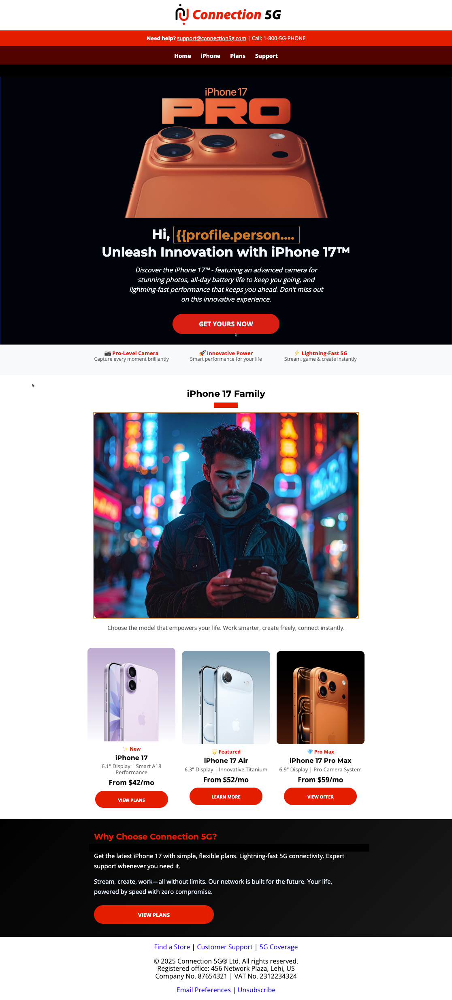

Cependant, l’équipe de conception vous fournit généralement des modèles de ce type :

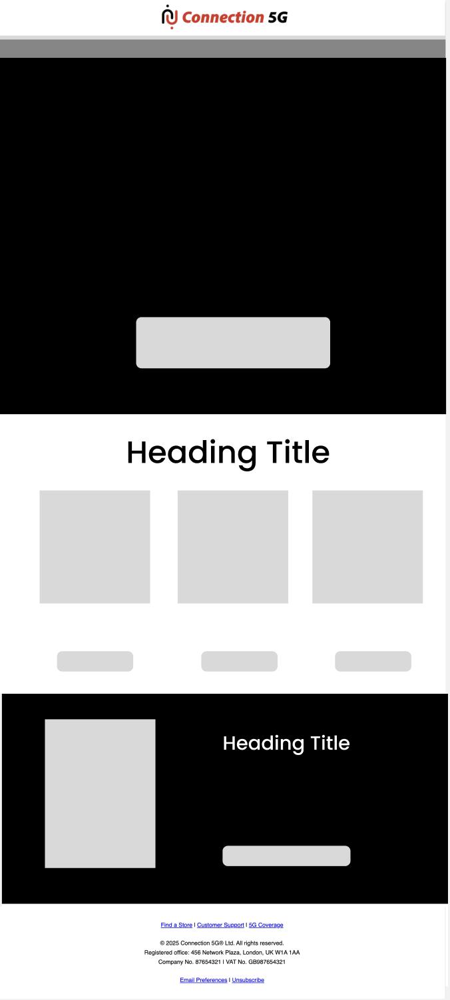

## Étape 1 : créer des fragments de contenu

Le modèle ci-dessous est un modèle de conception générique que nous avons pour objectif de diviser en blocs de contenu répétables. Dans l’optimiseur de parcours Adobe, il s’agit de **fragments**.

La première étape consiste à identifier le nombre de fragments que nous devons créer. Dans ce modèle, il est logique d’utiliser 5 fragments, comme illustré ci-dessous.

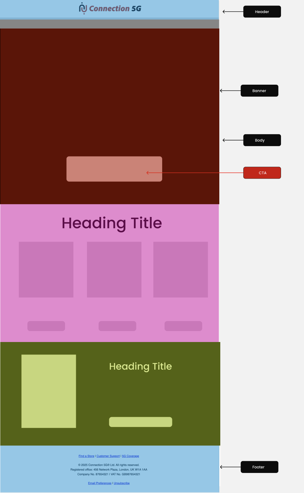

Nous avons identifié les modèles qui nécessitent 5 fragments comme suit.

- En-tête
- Bannière
- CTA
- Corps
- Pied de page

>[!NOTE]
>
>Pour cet exercice, vous ne créez qu’un seul fragment d’en-tête afin de gagner du temps.

Créez un fragment d’en-tête pour commencer. Toutefois, avant de créer le fragment, configurez un dossier de ressources, car l’environnement des ressources est partagé. Pour ce faire, créez d’abord votre propre dossier.

1. Dans le volet de navigation de gauche, recherchez la section **Gestion de contenu** et cliquez sur **Assets**.

   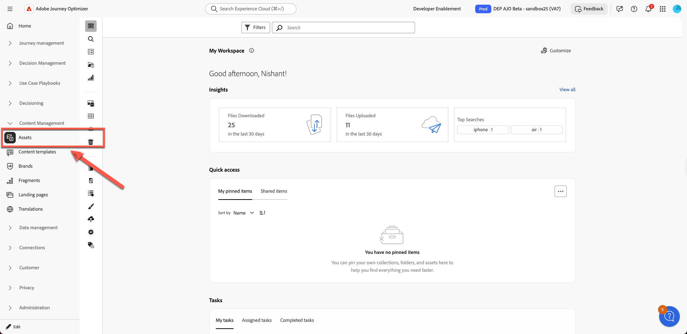

2. Cliquez sur **Assets** dans la section Gestion Assets.

   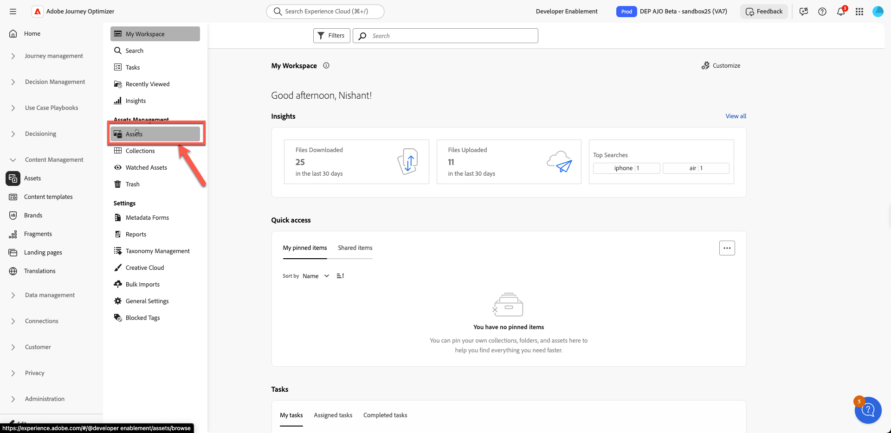

3. Créez un dossier en cliquant sur le bouton **« Créer un dossier »**.

   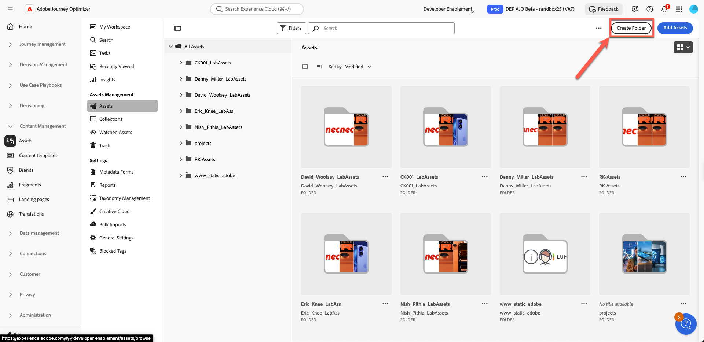

4. Donnez un nom comme votre prénom et votre nom. par ex. Nish\_Pithia\_LabAssets (élément dont vous vous souvenez)

   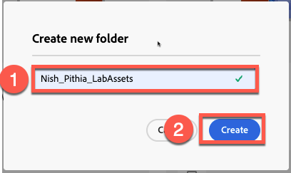

5. Double-cliquez sur le dossier que vous venez de créer pour **l&#39;ouvrir**. Cliquez ensuite sur **Ajouter Assets** et parcourez ou déposez toutes les images .png et .jpg à partir de votre dossier toolkit. Cliquez ensuite sur **Charger**

   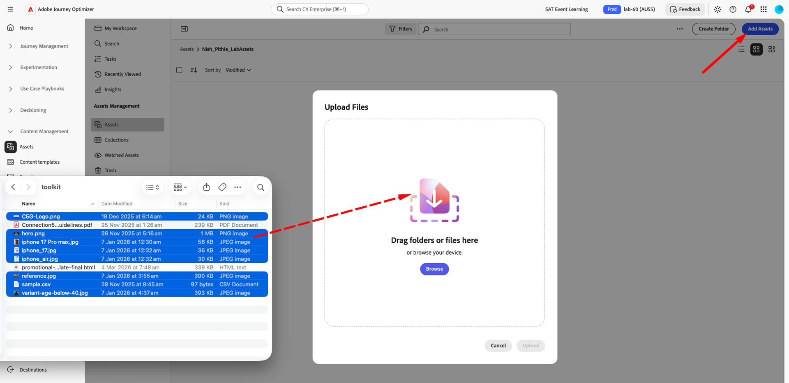

   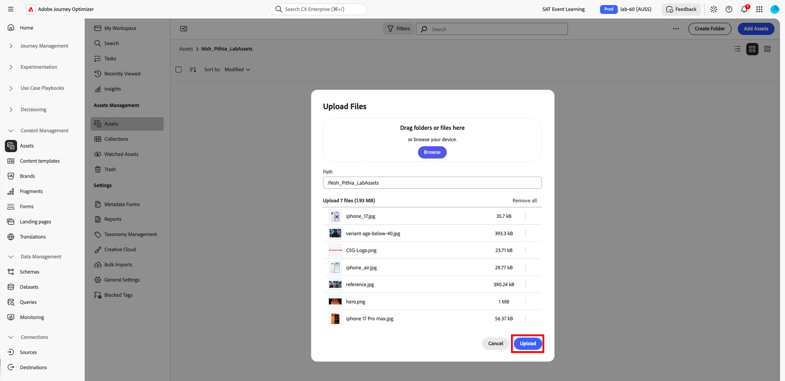

6. **Créer un fragment :** Sous Gestion de contenu, cliquez sur **Fragments** et créez un fragment.

   Option 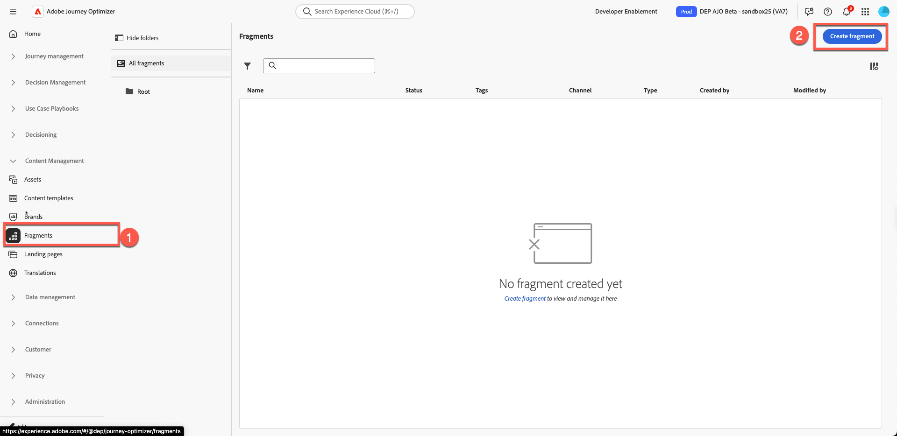

   Donnez un nom convivial, comme illustré ci-dessous. Ajoutez tous les détails comme suit :

   **Nom : En-Tête**

   **Description :** en-tête de fragment pour le modèle

   **Type :** Sélectionnez Fragment visuel

   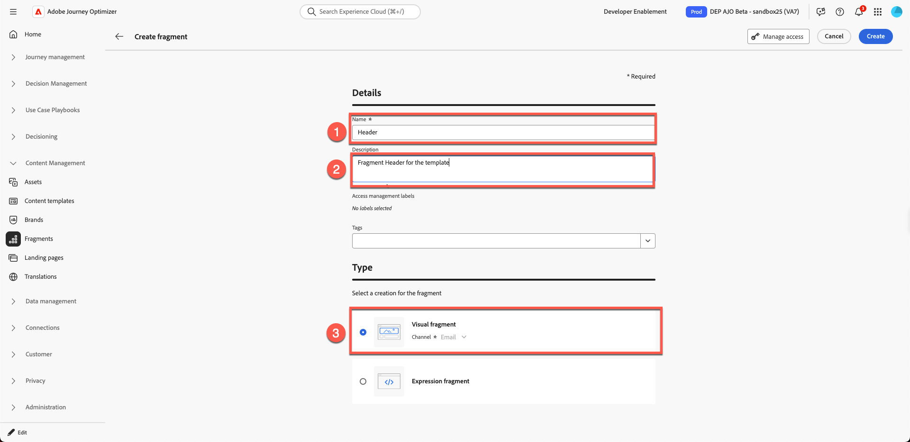

7. Cliquez sur le bouton **Créer** en haut à droite.

   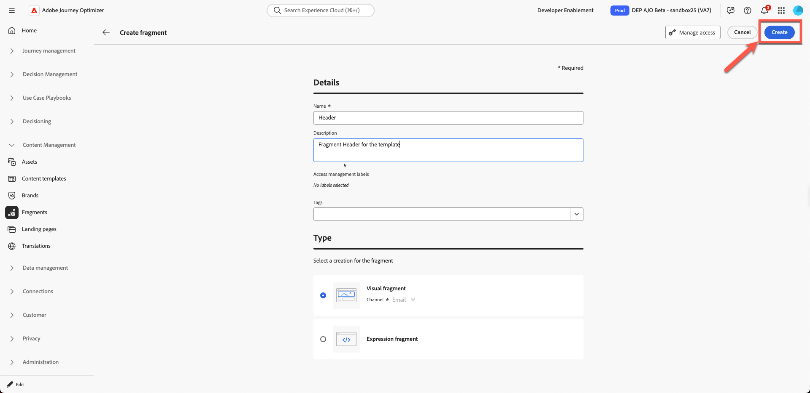

   Un écran de création de fragment vierge s’ouvre.

8. Accédez à l’onglet **Composants** dans la colonne de gauche. Cliquez ensuite sur **1:1 Column** sous Structures et faites glisser la zone de travail comme illustré ci-dessous. (Veuillez cliquer sur l&#39;image ci-dessous pour voir un graphique animé)

   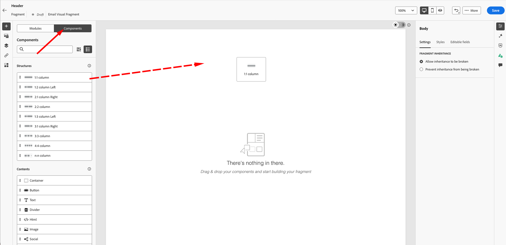

9. Ensuite, faites glisser « **image** » sur la ligne 1:1 que nous venons d’ajouter

   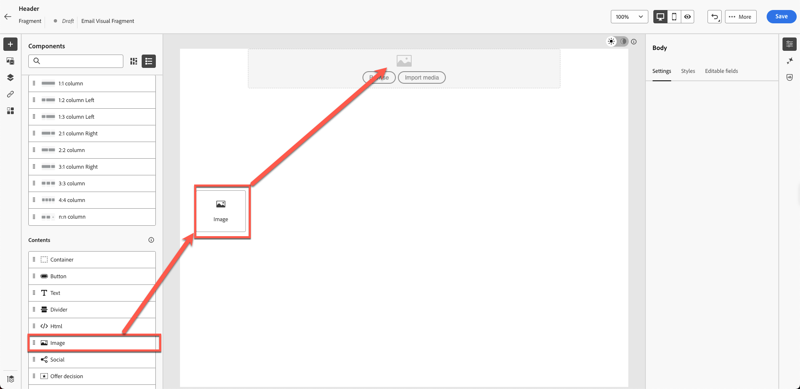

10. Cliquez sur **« Parcourir »** pour sélectionner l’image de logo qui vous a été fournie et qui a déjà été téléchargée sur Assets.

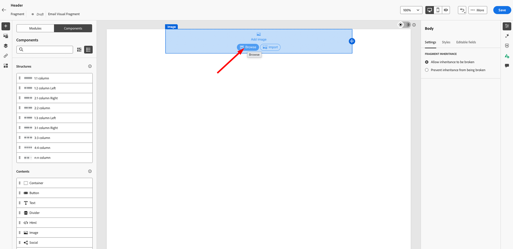

11. Accédez à votre dossier, cliquez sur l’image du logo (*C5G-Logo.png*) et cliquez sur **Sélectionner**.

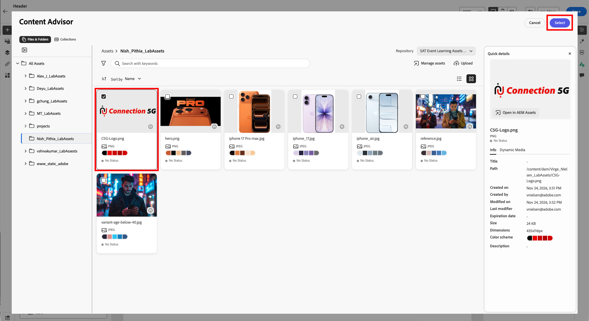

12. Le logo est placé correctement, mais il est trop grand et doit être redimensionné. Pour redimensionner le logo, mettez à jour ses propriétés. Cliquez sur l’onglet **Styles** dans la colonne de droite et définissez la largeur sur 40 % en faisant glisser le curseur, comme illustré ci-dessous.

>[!NOTE]
>
>Notez que lorsque le bouton de basculement est activé, le nombre 40 représente % et non les pixels. Si vous souhaitez une valeur absolue parfaite en pixels, faites basculer le bouton sur px.

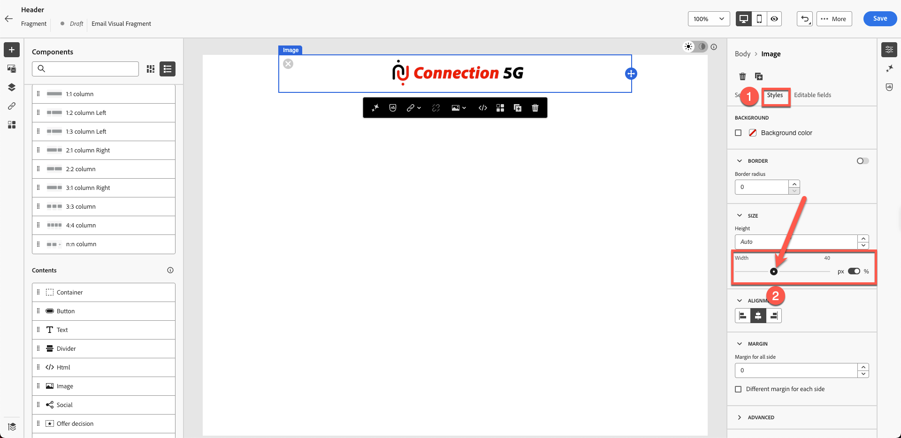

13. Cliquez sur **« Enregistrer »** pour enregistrer votre fragment. Une barre verte s’affiche lors de la confirmation.

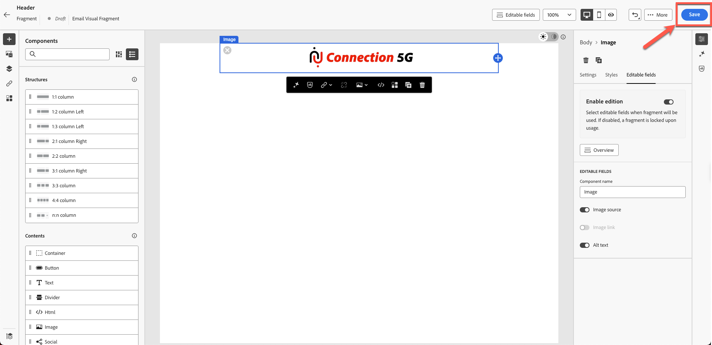

14. Le fragment enregistré est en mode brouillon. Avant de l’utiliser, vous devez le publier. Cliquez sur le bouton **retour**.

Bouton Précédent 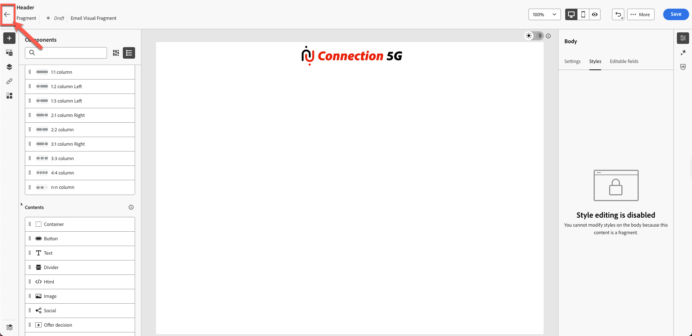

15. Cliquez sur le bouton « **Publier** ». Un message « Publication d’un fragment, cette opération peut prendre un certain temps. Nous vous avertirons dès que ce sera fait. » lors de la confirmation. Votre fragment est prêt à être utilisé pour la création de modèle.

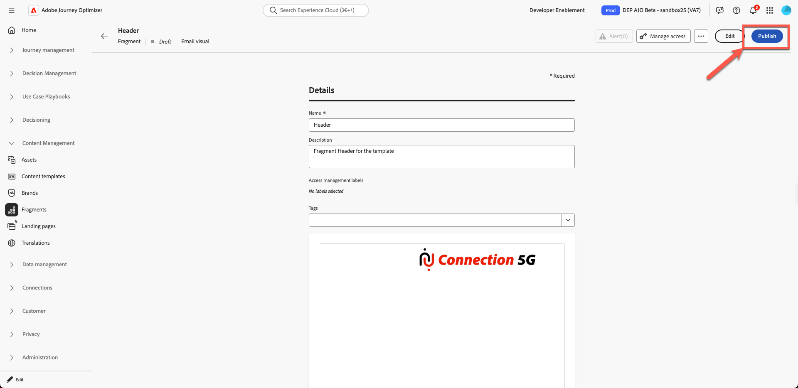

Le statut est passé à **« Actif »**. À ce stade, vous avez terminé la création d’un fragment d’en-tête, qui est utilisé à l’étape suivante.

Le statut du fragment d&#39;en-tête 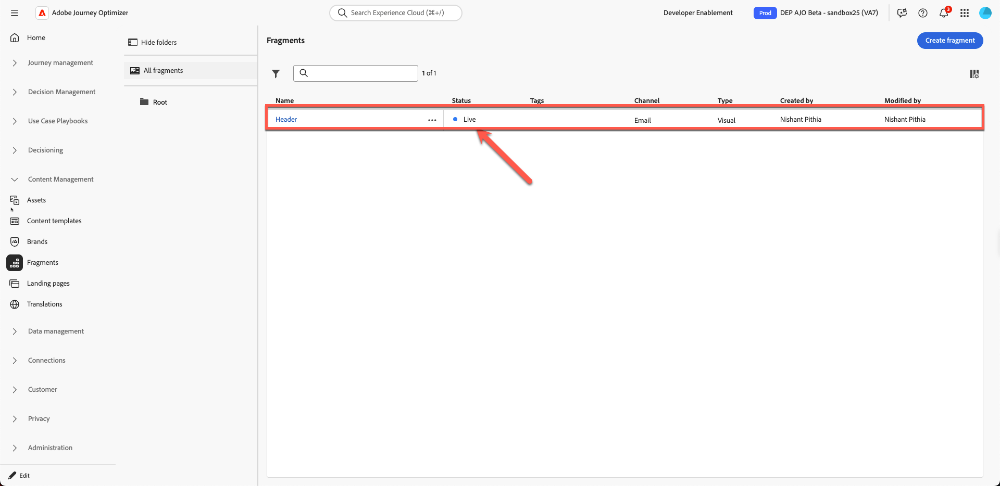

>[!NOTE]
>
>Notez que dans cet exercice, vous avez créé un seul fragment. Dans la pratique, les architectes peuvent choisir de créer plusieurs fragments, tels que des en-têtes, des pieds de page ou d’autres composants réutilisables.

## Récapituler

Dans ce module, vous avez réussi à :

- Répartition d’un e-mail en fragment d’en-tête réutilisable
- Création d’un en-tête de blocs de contenu

Vous êtes maintenant prêt à passer au module suivant : **Création d’un modèle de contenu**, où vous utiliserez le fragment que vous avez créé pour générer un nouveau modèle.
