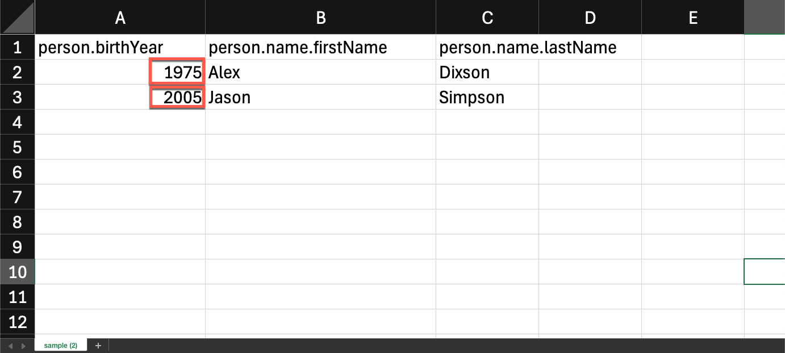
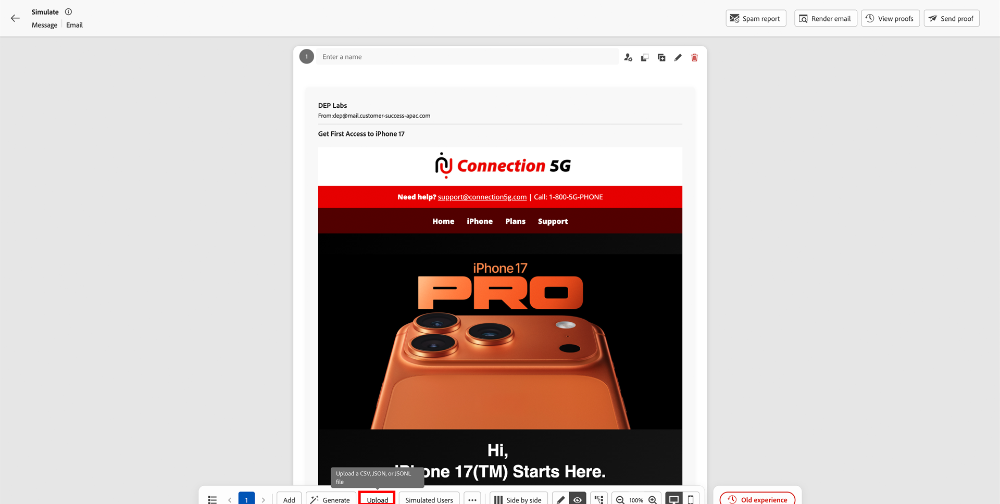

# Simulation de contenu

**Objectif :** valider la personnalisation, la logique conditionnelle et les variantes de contenu à l’aide des outils de simulation et de BAT de Adobe Journey Optimizer.

## Objectifs d’apprentissage

À la fin de ce module, vous serez en mesure de :

1. Chargez et utilisez les données de profil de test pour la simulation.
1. Validez les champs personnalisés et la logique de variante.
1. Testez le comportement de secours en cas de données manquantes ou non correspondantes.

## Introduction

Dans ce module, vous testerez votre e-mail avec **deux variantes conditionnelles** à l’aide de l’outil Simulation dans Adobe Journey Optimizer.
Vous pouvez ainsi prévisualiser la manière dont différents clients recevront votre message personnalisé, en veillant à la précision avant le lancement de la campagne.

Vous utiliserez l’exemple de fichier de profil de test **sample.csv** de votre boîte à outils.

## Ouvrir l’outil de simulation

1. Ouvrez l’e-mail que vous avez terminé.
2. Dans l’e-mail, cliquez sur **Simuler du contenu**.

Un panneau de simulation s’ouvre au bout de quelques secondes.

## Charger les données du profil de test

1. Cliquez sur **Charger** dans la partie inférieure pour charger les données d’entrée.

   

3. Choisissez **sample.csv** et cliquez sur **Continuer**.

   

AJO traite le fichier et prépare les aperçus en temps voulu.

## Vérifier le rendu des variantes

Lorsque vous cliquez sur Simuler du contenu dans votre e-mail, AJO affiche les variantes côte à côte en fonction des profils chargés.

**Résultats attendus :**

- **Alex** → Voir **Variante 1** (Âge Supérieur À 40 Ans)
Cliquez sur l’icône en forme de crayon au-dessus de la première variante pour **Afficher les détails de la variante**

La carte s’inverse pour afficher les détails sur lesquels la personnalisation est basée

- **Jason** → Voir **Variante 2** (Âge Inférieur À 40 Ans)
Cliquez sur l’icône en forme de crayon au-dessus de la deuxième variante pour **Afficher les détails de la variante**

Basculez la vue de Côte à Côte vers **Empilé verticalement** pour examiner les détails et la personnalisation de Jason côte à côte

Lorsque vous faites défiler le contenu de l’e-mail, vous pouvez voir le nom complet de Jason ainsi que l’image de contenu conditionnel que nous avons choisie. Comme c&#39;est cool !

## Validation du comportement de secours

**Secours et valeurs par défaut :** Vérifiez que votre e-mail gère correctement les données manquantes ou les scénarios de non-correspondance. Par exemple, simulez un profil avec un champ d’année de naissance vide ou qui n’est éligible à aucune offre ciblée. L’aperçu doit afficher un bloc de contenu par défaut ou un espace réservé pratique au lieu d’un contenu rompu ou vide. Si votre simulation affiche une section vide où le contenu doit se trouver, cela indique que vous devrez peut-être configurer une offre de secours ou un texte par défaut dans votre conception.

## Récapituler

Dans ce module, vous avez réussi à :

- Simulation de contenu personnalisé à l’aide de profils types
- Logique de changement de variante validée
- Les champs personnalisés confirmés sont correctement renseignés

Vous êtes maintenant prêt pour le module suivant : **Alignement des marques**,
où vous évaluerez votre e-mail par rapport aux directives de la marque Connection 5G à l’aide de l’IA.
