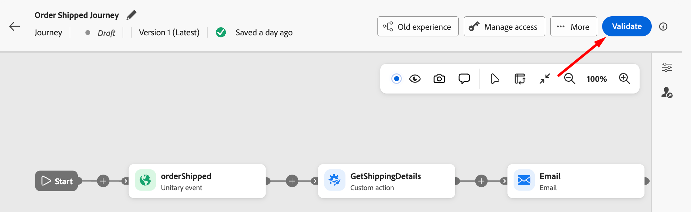
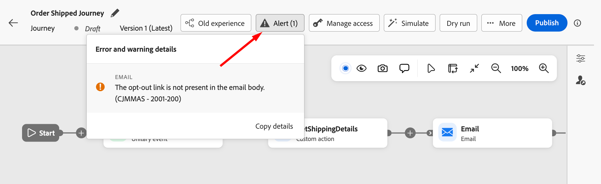
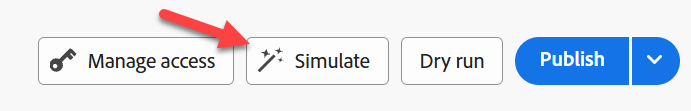
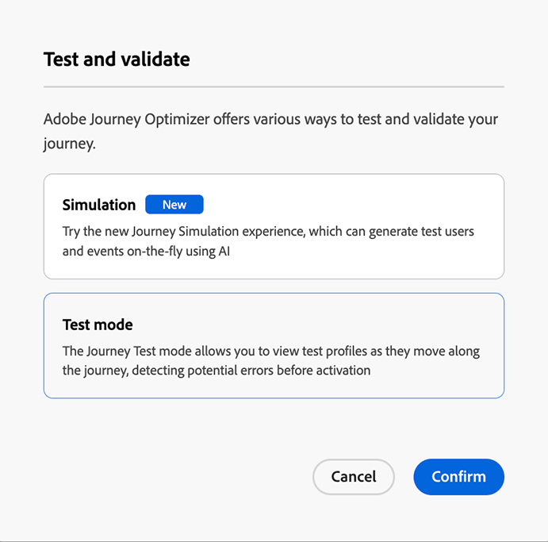
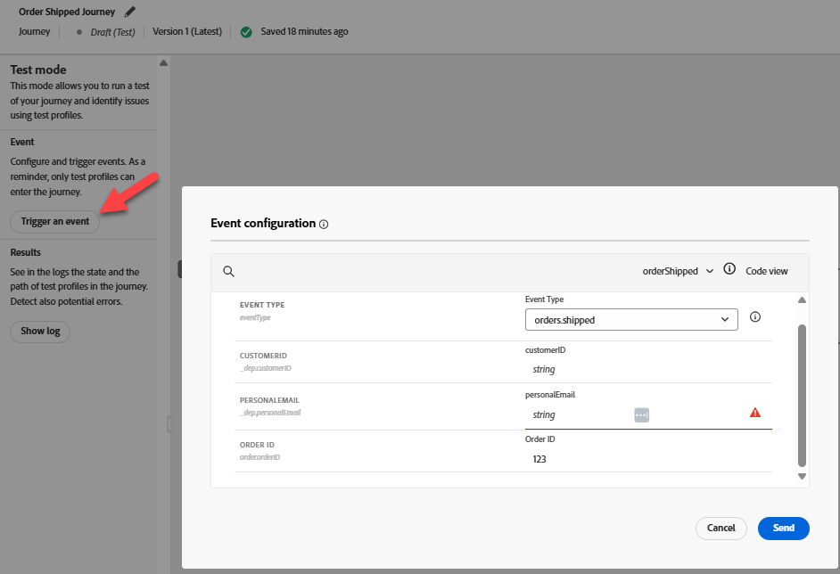
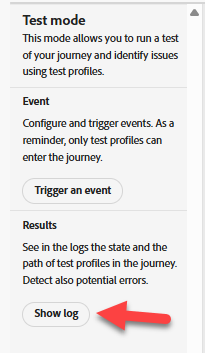
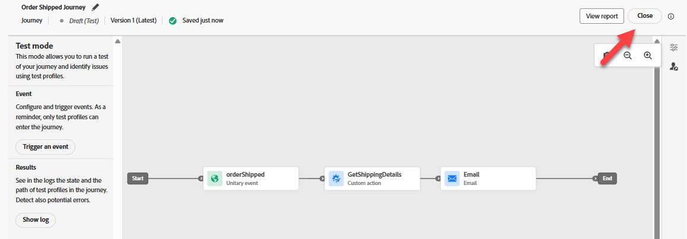
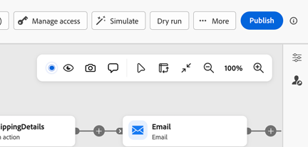
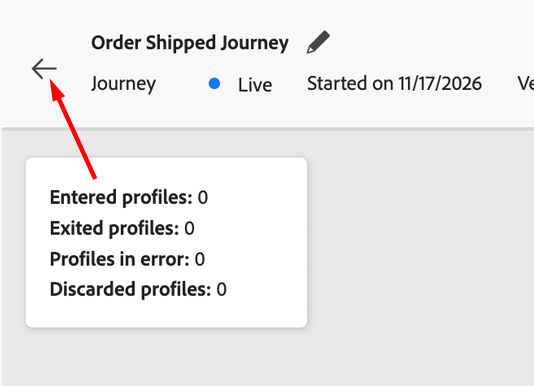

# Parcours de test

## Objectif d’apprentissage

Utilisez les outils de test de parcours pour vérifier que le déclencheur d’événement et la logique de parcours sont correctement configurés.

## Tester le parcours

1. Si vous n’êtes pas déjà dans le parcours, cliquez sur **Parcours** dans le rail de gauche et sur l’**onglet Parcourir** si vous ne voyez pas de liste de Parcours
2. Cliquez sur votre **Parcours** pour l’ouvrir
3. Premier clic sur le bouton **Valider** en haut à droite

   

&#x200B;5. Cliquez sur **Alertes** et vérifiez qu’il n’y a aucune erreur (les avertissements sont ouverts).

   

   >[!NOTE]
   >
   >**Qu’est-ce que CJMMAS - 2001-200**
   >
   >Indique que le lien d’opt-out est manquant dans une variante d’e-mail

&#x200B;6. Cliquez sur le bouton **Simuler**, puis sélectionnez **Mode test**

   

   


   >[!NOTE]
   >
   >Il faudra peut-être une minute pour se préparer. Pendant ce temps, le bouton Déclencher un événement n’est pas disponible.


&#x200B;7. Cliquez sur **Déclencher un événement** sur le côté gauche et renseignez ces propriétés :
   - **Type D’Événement** : `orders.shipped`
   - **E-Mail Personnel** : `henry.creel@emailsim.io`
   - **ID de commande** : `123`
&#x200B;8. Cliquez sur **Envoyer** (notez qu&#39;il faut quelques secondes pour répondre après avoir cliqué sur Envoyer)

   

   >[!WARNING]
   >
   >Certains étudiants ont des erreurs et doivent les envoyer plusieurs fois. Vous devrez peut-être effectuer cette opération **plusieurs fois**.
   >
   >**Parfois** le premier envoi donne une erreur de :
   >
   >**L&#39;entrée n&#39;existe pas (ID de référence : 3216a850-c40d-11f0-8fa5-73d1522cc9a2)**
   >
   >Si vous obtenez une erreur, cliquez sur **Déclencher un événement**, puis sur **envoyer** à nouveau.  Vous devrez peut-être effectuer cette opération **plusieurs fois**.


&#x200B;9. Sous **Résultats** -> Cliquez sur **Afficher le journal** sur le côté gauche



>[!NOTE]
>
>Certains élèves qui ont reçu des erreurs reçoivent parfois différents journaux affichant un tableau d’instances vide `{"instances": []}`. Ceci n&#39;est pas un bloqueur, allez-y et passez à l&#39;étape suivante.

Vous devriez voir un élément similaire à ceci dans le journal :

>[!NOTE]
>
>Nous recherchons les champs clés utilisés : **actionsHistory**, **transitionsHistory**, **eta**, **tracking_number**, **eventType**, **personalEmail** et **orderID**.

```json
{
  "actionsHistory": {
    "8919055f-1b00-4a43-8bd6-c8af894474b2": {
      "eta": "11/27/2025",
      "tracking_number": "091204404",
      "jo_status_code": "http_200"
    }
  },
  "transitionsHistory": {
    "orderShipped (1158856989)": {
      "eventType": "orders.shipped",
      "_id": "joTestModeEvent_5abbfdcd-561d-45a7-ba42-d0640539831a",
      "_dep": {
        "personalEmail": "henry.creel@emailsim.io"
      },
      "order": {
        "orderID": "123"
      },
      "timestamp": "2025-11-17T23:30:49.576289372Z"
    }
  }
}
```


1. **Fermez** l’**onglet** du navigateur pour le journal
1. **Fermer le mode Test** en haut à droite

   

1. Cliquez de nouveau sur **Valider**, puis sur **Publier** le Parcours en haut à droite

   

1. **Fermez** le **Parcours** en cliquant sur la flèche \&lt;- en haut à gauche



Ensuite, nous enverrons un événement réel de commande expédiée dans AEP

## Récapituler

Le parcours a réussi la validation de la configuration et est prêt à recevoir des événements
