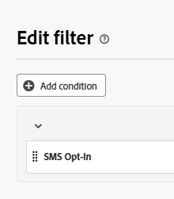
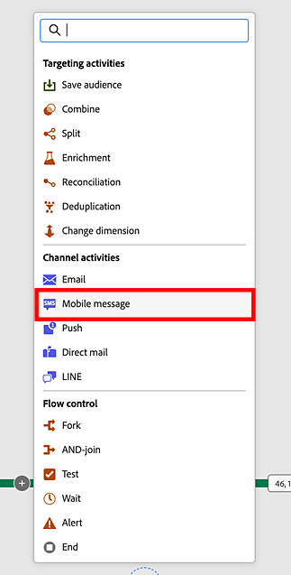

# Filtrer les lignes

## Objectif

Dans les étapes suivantes, vous allez filtrer toutes les lignes qui ne sont pas réellement autorisées à être ciblées avec un SMS en raison de leur opt-out au niveau de la ligne.  Vous ne pouvez pas vous fier ici au consentement du profil, car il s’agit d’une cible au niveau de la ligne.

## Configurer l’activité de partage

1. Cliquez sur l’icône **+** sur la transition inférieure de l’activité Branchement et sélectionnez l’activité **Fractionner** dans la fenêtre contextuelle.

   

2. Dans le rail de droite, mettez à jour le Libellé pour indiquer ce qui suit : `Filter out opt'd out lines`

   

3. Dans le rail de droite, développez la section Segment par défaut **Sous-ensemble** et cliquez sur le bouton **Créer un filtre**

   

4. Ajoutez une condition pour vous assurer de supprimer toutes les lignes client exclues de la messagerie SMS, puis cliquez sur **Confirmer**.

   

   >[!NOTE]
   >
   >Vous devez comprendre comment créer la condition, mais le résultat final correspond à la capture d’écran ci-dessus.  C&#39;est bon !

5. Cliquez sur le bouton Enregistrer en haut à droite pour enregistrer votre travail.  Votre zone de travail ressemble à ceci maintenant\...

## Ajouter une dimension de modification

1. Dans la zone de travail du workflow, cliquez sur l’icône **+** après la condition de partage que vous avez ajoutée et sélectionnez l’activité **Modifier la dimension**

   

2. Mettez à jour les propriétés de la dimension de modification comme indiqué ci-dessous et cliquez sur **Confirmer** :
Libellé : `Convert Line to Account`
Nouvelle dimension cible : `dep-rel: Customer Account`

   

   

## Ajouter l’activité SMS

1. Cliquez sur l’icône **+** après la dimension Modifier que vous avez ajoutée et sélectionnez l’**Activité de message mobile**

   

   

2. Dans le rail de droite, cliquez sur le bouton **Modifier le message mobile** pour démarrer la configuration du SMS

   

3. Dans le volet de navigation supérieur, cliquez sur l’élément de menu Actions , puis dans le menu déroulant Configuration du message mobile , sélectionnez le canal que vous avez précédemment créé.

>[!CAUTION]
>
>Oh non 🫨 !  Pourquoi n’obtenez-vous aucun résultat ?  N’avez-vous pas déjà configuré votre canal SMS ?  Le produit est-il cassé ?
>
>PANIQUE!!!!!!!!!

## Moment d’interruption

La configuration du canal pour les SMS a déjà été configurée par vous au préalable et elle ressemble actuellement à ceci...

**Voici comment vous lisez ceci :**

- Diffusez un message par dimension cible (par exemple, Compte client) sur le nombre d’enregistrements associés trouvés dans la dimension secondaire (par exemple, Ligne client)
- Exécutez chaque diffusion SMS à l’aide du numéro de téléphone mobile figurant dans la dimension secondaire (c’est-à-dire Ligne du client)

Cette capacité unique d’envoyer de nombreux messages à un profil est l’une des principales fonctionnalités des campagnes orchestrées, qui la différencie des Parcours. Cependant, votre transition menant à l’activité Message mobile est définie sur Compte client. Vous pouvez ainsi la joindre à nouveau au profil client en temps réel au moment de l’envoi, de sorte que les informations de diffusion et de suivi des messages soient attribuées à un profil.

Comment faire pour que ça marche ? Modifiez la cible pour l’exécution du message afin qu’elle corresponde à la configuration de votre canal 😀

## Modifier Target et terminer la configuration des messages SMS

1. Cliquez sur le bouton Précédent dans l’écran de modification des SMS

   Bouton Précédent 

2. Une fois l’activité de message mobile sélectionnée, dans le rail de droite, modifiez d’abord le choix de Target de l’option par défaut d’un message par profil en **Un message par dimension secondaire**, puis cliquez de nouveau sur **Modifier le message mobile**

   

3. Dans le volet de navigation supérieur, cliquez sur l’élément de menu **Actions**, puis dans le menu déroulant Configuration du message mobile , sélectionnez le canal que vous avez précédemment créé.

   

## Récapituler

Vous avez filtré toutes les lignes qui n’étaient pas autorisées à être ciblées avec un SMS en raison de l’opt-out, vous avez modifié la dimension de ligne en compte et à la fin, vous avez correctement configuré l’activité SMS pour celles qui étaient autorisées à être ciblées.
J’espère que vous avez également appris une chose très importante : **votre cible doit correspondre à la configuration de canal que vous souhaitez utiliser**
