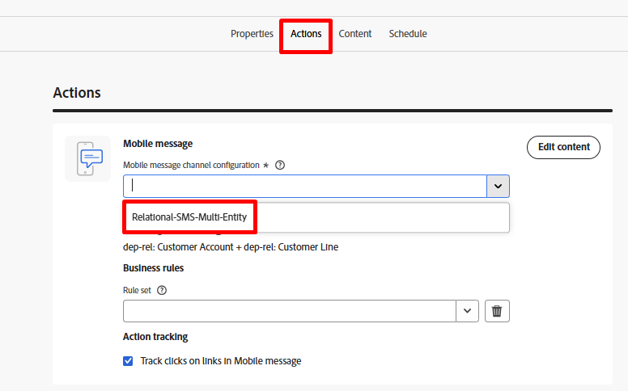

# Filtrer les lignes

## Objectif

Dans les étapes suivantes, vous allez filtrer toutes les lignes qui ne sont pas réellement autorisées à être ciblées avec un SMS en raison de leur opt-out au niveau de la ligne.  Vous ne pouvez pas vous fier ici au consentement du profil, car il s’agit d’une cible au niveau de la ligne.

## Configurer l’activité de partage

1. Cliquez sur l’icône **+** sur la transition inférieure de l’activité Branchement et sélectionnez l’activité **Fractionner** dans la fenêtre contextuelle.

   

2. Dans le rail de droite, mettez à jour le Libellé pour indiquer ce qui suit : `Filter out opt'd out lines`

   

3. Dans le rail de droite, développez la section Segment par défaut **Sous-ensemble** et cliquez sur le bouton **Créer un filtre**

   

4. Ajoutez une condition pour vous assurer de supprimer toutes les lignes client exclues de la messagerie SMS, puis cliquez sur **Confirmer**.

   

   >[!NOTE]
   >
   >Vous devez comprendre comment créer la condition, mais le résultat final correspond à la capture d’écran ci-dessus.  C&#39;est bon !

5. Cliquez sur le bouton Enregistrer en haut à droite pour enregistrer votre travail.  Votre zone de travail ressemble à ceci maintenant\...

## Ajouter l’activité SMS

1. Dans la zone de travail du workflow, cliquez sur l’icône **+** après la condition de partage que vous avez ajoutée et sélectionnez l’**Activité de message mobile**

   

   

2. Dans le rail de droite, cliquez sur le bouton Modifier le message mobile pour démarrer la configuration du SMS

   

3. Dans le volet de navigation supérieur, cliquez sur l’élément de menu Actions , puis dans le menu déroulant Configuration du message mobile , sélectionnez le canal que vous avez précédemment créé.

## Récapituler

Vous avez filtré toutes les lignes qui n’ont pas été autorisées à être ciblées avec un SMS en raison de votre désinscription et vous avez ajouté une activité SMS pour celles qui ont été autorisées à être ciblées.
